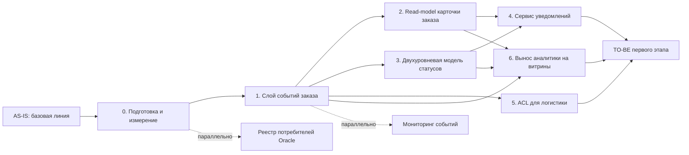

# roadmap инкрементальной миграции RetailCore

> Назначение документа: показать безопасный путь от AS-IS к TO-BE первого этапа через промежуточные состояния, зависимости, риски, условия остановки и критерии завершения этапов.

## 0. Паспорт roadmap

| Поле | Значение |
|---|---|
| Название проекта | RetailCore - инкрементальная трансформация платформы обработки заказов |
| Связанный документ трансформации | `Task3/transformation.md` |
| Горизонт планирования | Первый этап (пилот, 3–6 месяцев) |
| Выбранная стратегия миграции | Incremental Migration (поэтапная) |
| Ключевые паттерны | Strangler Fig (обёртка вокруг монолита), ACL, Event-Driven, Read-Model |
| Автор | Самый главный архитектор среди самых главных архитекторов |
| Версия | 1.0 |

## 1. Краткое резюме roadmap

Миграция выполняется инкрементально, потому что нельзя останавливать критический order flow и нет окна на взрывную нагрудзку; Java-монолит и Oracle связаны слишком сильно, чтобы заменять их одномоментно. Сначала команда фиксирует базовую линию метрик и строит слой событий заказа - он станет основой для всех последующих изменений. Затем запускается безопасный пилотный контур: read-model карточки заказа и двухуровневая модель статусов, чтобы поддержка и клиент видели единую картину. После этого подключается сервис уведомлений и ACL для логистики, изолирующий смешанные интеграции. На последнем этапе аналитика переводится на витрины, а ядро разгружается от прямых запросов.

Такой порядок выбран из-за зависимостей: слой событий должен появиться до read-model и уведомлений; модель статусов должна быть согласована до того, как на неё подпишутся потребители; ACL для логистики нельзя включать без идемпотентной обработки. Основные риски roadmap связаны с расхождением read-model и Oracle, потерей событий и ростом нагрузки на инфраструктуру. Для каждого этапа заданы критерии готовности и условия остановки.

## 2. Стартовое и целевое состояние

| Состояние | Описание | Ключевые ограничения | Метрики / признаки состояния |
|---|---|---|---|
| AS-IS | Java-монолит + Oracle как центр; смешанные интеграции; статусы размазаны; аналитика читает операционную БД | Нельзя останавливать order flow; on-premise; нет SLA/SLO | Средние значения по метрикам ещё не собраны |
| Промежуточное состояние 1 | Появляется слой событий заказа; ядро не меняется | Oracle остаётся источником истины | Доля заказов с событиями ≥ 99% |
| Промежуточное состояние 2 | Read-model карточки заказа и двухуровневая модель статусов работают для поддержки | Ядро всё ещё пишет статусы по-старому | Время сборки истории ≤ 5 с; обращения по статусу −30% |
| Промежуточное состояние 3 | Сервис уведомлений и ACL для логистики подключены | Часть партнёров идёт через легаси .NET | Доля доставленных уведомлений ≥ 98%; дубли −90% |
| TO-BE первого этапа | Аналитика на витринах; операционная Oracle разгружена; ядро не тронуто | Полный отказ от Oracle отложен | Доля аналитических запросов в операционной Oracle −50% |

## 3. Принципы построения roadmap

- **Сначала измеряем, потом меняем:** baseline по времени сборки истории, обращениям по статусу, нагрузке на Oracle, дублям логистики.
- **Сначала изолируем риск, потом расширяем сценарий:** слой событий - сначала только публикация, без изменения ядра.
- **Сначала управляемый пилот, потом масштабирование:** read-model и статусы сначала для поддержки, потом для остальных потребителей.
- **Сначала модель состояний, потом коммуникация:** двухуровневая модель статусов до сервиса уведомлений.
- **Сначала реестр потребителей данных, потом декомпозиция:** перед выносом аналитики найти все прямые SQL к операционной Oracle.

## 4. Roadmap миграции

| Этап | Цель | Промежуточное состояние | Основные работы | Зависимости | Риски | Критерии завершения |
|---|---|---|---|---|---|---|
| AS-IS | Зафиксировать стартовую точку | Описанное текущее состояние | Сбор baseline, инвентаризация интеграций и потребителей Oracle | - | Неполные данные | Baseline подтверждён |
| 0. Подготовка и измерение | Собрать базовую линию и описать контракты событий | Готов слой контрактов, baseline по метрикам | Метрики, реестр потребителей, схема событий, границы пилота | Доступ к логам и мониторингу | Неполные метрики | Baseline согласован; контракты событий утверждены |
| 1. Слой событий заказа | Публиковать бизнес-события заказа без изменения ядра | События публикуются после транзакции | Публикация событий из монолита, очередь/шина, мониторинг доставки | Этап 0 | Потеря событий; нагрузка | Доля заказов с событиями ≥ 99% |
| 2. Read-model карточки заказа | Дать поддержке единую картину заказа | Read-model работает для поддержки | Модель чтения, обновление из событий, интеграция с admin tools | Этап 1 | Расхождение с Oracle | Время сборки истории ≤ 5 с; расхождение ≤ 1% |
| 3. Двухуровневая модель статусов | Убрать расхождения статусов | Модель статусов и журнал работают | Согласование статусов, маппинг, журнал, отображение | Этап 1 | Ломает существующие переходы | Обращения по статусу −30% |
| 4. Сервис уведомлений | Дать клиенту объяснимость | Уведомления работают по событиям | Сервис уведомлений, повторы, журнал доставки | Этапы 1, 3 | Дубли и потери | Доля доставленных ≥ 98% |
| 5. ACL для логистики | Унифицировать интеграции и убрать дубли | ACL работает для части партнёров | Единый контракт, retry, идемпотентность | Этап 1 | Дубли, потеря статусов | Дубли −90%; ошибки −50% |
| 6. Вынос аналитики на витрины | Разгрузить операционную Oracle | Витрины строятся из событий | Витрины, замена прямых SQL, реестр отчётов | Этапы 1, 2 | Расхождение отчётов | Доля запросов в операционную Oracle −50% |
| TO-BE первого этапа | Проверить достижение целевого состояния | Работающий целевой контур | Финальные проверки, сверка метрик | Все этапы | Остаточные риски | Целевые метрики достигнуты |

## 5. Детализация этапов

### Этап 0. Подготовка и измерение

| Раздел | Содержание |
|---|---|
| Цель этапа | Собрать baseline и утвердить контракты событий |
| Какие точки трансформации закрывает | Подготовительный этап для всех точек |
| Что меняется в процессе | Ничего для пользователя; появляются метрики и контракты |
| Что меняется в архитектуре | Схема событий, реестр потребителей данных |
| Что не меняется | Ядро, Oracle, checkout |
| Входные условия | Доступ к логам и мониторингу |
| Выходные условия | Baseline согласован; контракты событий утверждены |
| Метрики этапа | Полнота baseline по 6 ключевым метрикам |
| Риски этапа | Неполные метрики, отсутствие baseline |
| Условие остановки | Baseline нельзя подтвердить |

### Этап 1. Слой событий заказа

| Раздел | Содержание |
|---|---|
| Цель этапа | Публиковать бизнес-события заказа после транзакции |
| Какие точки трансформации закрывает | Точка 3 из `transformation.md` |
| Что меняется в процессе | Нет видимых изменений для клиента и поддержки |
| Что меняется в архитектуре | Новый слой событий; публикация из монолита |
| Что не меняется | Ядро, Oracle, checkout, payment orchestration |
| Входные условия | Контракты событий утверждены |
| Выходные условия | События публикуются стабильно; мониторинг работает |
| Метрики этапа | Доля заказов с событиями ≥ 99% |
| Риски этапа | Потеря событий, нагрузка на монолит |
| Условие остановки | Потеря > 1% событий |

### Этап 2. Read-model карточки заказа

| Раздел | Содержание |
|---|---|
| Цель этапа | Единая карточка заказа для поддержки |
| Какие точки трансформации закрывает | Точка 1 |
| Что меняется в процессе | Поддержка работает через единую карточку |
| Что меняется в архитектуре | Модель чтения, обновление из событий |
| Что не меняется | Ядро, Oracle, admin tools (UI меняется) |
| Входные условия | Слой событий работает |
| Выходные условия | Read-model стабильно обновляется |
| Метрики этапа | Время сборки истории ≤ 5 с; расхождение ≤ 1% |
| Риски этапа | Устаревшие данные, расхождение с Oracle |
| Условие остановки | Расхождение > 1% |

### Этап 3. Двухуровневая модель статусов

| Раздел | Содержание |
|---|---|
| Цель этапа | Убрать расхождения между клиентским и внутренним статусом |
| Какие точки трансформации закрывает | Точка 2 |
| Что меняется в процессе | Клиент видит понятный статус; поддержка - детализацию |
| Что меняется в архитектуре | Модель статусов, журнал переходов |
| Что не меняется | Внутренние статусы партнёров |
| Входные условия | Слой событий работает |
| Выходные условия | Статусы согласованы; журнал ведётся |
| Метрики этапа | Обращения по статусу −30% |
| Риски этапа | Рост обращений, неверный маппинг |
| Условие остановки | Рост обращений после релиза |

### Этап 4. Сервис уведомлений

| Раздел | Содержание |
|---|---|
| Цель этапа | Объяснимость состояния заказа для клиента |
| Какие точки трансформации закрывает | Точка 6 |
| Что меняется в процессе | Клиент получает уведомления о статусе |
| Что меняется в архитектуре | Новый сервис уведомлений |
| Что не меняется | Каналы вне пилота |
| Входные условия | Слой событий и модель статусов работают |
| Выходные условия | Уведомления доставляются стабильно |
| Метрики этапа | Доля доставленных ≥ 98% |
| Риски этапа | Дубли, потери |
| Условие остановки | Доля доставленных < 95% |

### Этап 5. ACL для логистики

| Раздел | Содержание |
|---|---|
| Цель этапа | Унифицировать интеграции, убрать дубли |
| Какие точки трансформации закрывает | Точка 4 |
| Что меняется в процессе | Операционный блок работает через единый контракт |
| Что меняется в архитектуре | ACL с retry и идемпотентностью |
| Что не меняется | Логика выбора маршрута в Oracle |
| Входные условия | Слой событий работает |
| Выходные условия | ACL стабильно обрабатывает интеграции |
| Метрики этапа | Дубли −90%; ошибки −50% |
| Риски этапа | Дубли, потеря статусов |
| Условие остановки | Рост дублей |

### Этап 6. Вынос аналитики на витрины

| Раздел | Содержание |
|---|---|
| Цель этапа | Разгрузить операционную Oracle |
| Какие точки трансформации закрывает | Точка 5 |
| Что меняется в процессе | Аналитика читает витрины вместо операционной БД |
| Что меняется в архитектуре | Витрины из событий и read-model |
| Что не меняется | Oracle остаётся источником истины |
| Входные условия | Слой событий и read-model работают |
| Выходные условия | Витрины покрывают ключевые отчёты |
| Метрики этапа | Доля запросов в операционную Oracle −50% |
| Риски этапа | Расхождение отчётов |
| Условие остановки | Расхождение отчётов > порога |

## 6. Зависимости между этапами

### 6.1. Таблица зависимостей

| Зависимость | Почему порядок жёсткий | Что будет, если нарушить порядок | Как контролируем |
|---|---|---|---|
| Этап 1 (события) до этапа 2 (read-model) | Read-model строится на событиях | Нет источника данных для модели чтения | Контракты событий утверждены до старта |
| Этап 1 (события) до этапа 3 (статусы) | Журнал переходов работает по событиям | Нет данных для маппинга статусов | Схема событий включает статусы |
| Этап 1 (события) до этапа 4 (уведомления) | Уведомления триггерятся событиями | Нет источника для уведомлений | События включают ключевые переходы |
| Этап 1 (события) до этапа 5 (ACL) | ACL публикует статусы логистики в события | Нет канала для унифицированных статусов | ACL интегрирован с событиями |
| Этапы 2 и 3 до этапа 4 (уведомления) | Уведомления используют статусы и read-model | Уведомления могут содержать неверные данные | Статусы и read-model стабильны до этапа 4 |
| Этапы 1, 2 до этапа 6 (аналитика) | Витрины строятся из событий и read-model | Витрины неполные | Реестр отчётов сверен до старта |
| Этапы 2 и 3 можно параллельно | Read-model и статусы независимы | Может возникнуть конкуренция за ресурсы | План ресурсов и релизов |

## 7. Управление рисками roadmap

| Этап | Риск | Вероятность | Влияние | Контроль | Условие остановки | Владелец |
|---|---|---:|---:|---|---|---|
| 0. Подготовка | Неполные метрики | Высокая | Среднее | Сверка источников | Baseline не подтверждён | Аналитика |
| 1. События | Потеря событий | Низкая | Высокое | Мониторинг публикации | Потеря > 1% | Техлид |
| 1. События | Нагрузка на монолит | Средняя | Среднее | Лимиты публикации | Деградация ядра | Техлид |
| 2. Read-model | Расхождение с Oracle | Средняя | Среднее | Сверка, метрики расхождения | Расхождение > 1% | Команда заказов |
| 2. Read-model | Устаревшие данные | Средняя | Среднее | Контроль свежести | Данные старше порога | Команда заказов |
| 3. Статусы | Рост обращений | Средняя | Среднее | Мониторинг обращений | Рост после релиза | Поддержка |
| 3. Статусы | Неверный маппинг | Средняя | Высокое | Тесты, проверка на пилоте | Расхождение статусов | Команда заказов |
| 4. Уведомления | Дубли и потери | Средняя | Среднее | Идемпотентность | Доля доставленных < 95% | Команда клиентского опыта |
| 5. ACL | Дубли логистических заявок | Средняя | Среднее | Идемпотентность, дедупликация | Рост дублей | Команда логистики |
| 5. ACL | Потеря статусов доставки | Низкая | Высокое | Мониторинг статусов | Потеря статусов | Команда логистики |
| 6. Аналитика | Расхождение отчётов | Высокая | Среднее | Сверка с Oracle | Расхождение > порога | Аналитика |
| 6. Аналитика | Неполное покрытие отчётов | Средняя | Среднее | Реестр отчётов | Не покрыто > 20% | Аналитика |

## 8. Метрики и контрольные точки

| Контрольная точка | Когда проверяем | Что проверяем | Целевой порог | Источник данных | Решение по результату |
|---|---|---:|---|---|---|
| После этапа 0 | Baseline | 6 ключевых метрик | Все зафиксированы | Логи, мониторинг | Продолжить / доработать baseline |
| После этапа 1 | Стабильность событий | Доля заказов с событиями | ≥ 99% | Слой событий | Продолжить / остановить |
| После этапа 2 | Read-model | Время сборки истории | ≤ 5 с | Карточка заказа | Продолжить / расширить / откатить |
| После этапа 3 | Статусы | Обращения по статусу | −30% | CRM | Продолжить / доработать |
| После этапа 4 | Уведомления | Доля доставленных | ≥ 98% | Сервис уведомлений | Продолжить / расширить |
| После этапа 5 | ACL | Дубли логистики | −90% | ACL / логистика | Продолжить / расширить |
| После этапа 6 | Аналитика | Доля запросов в операционную Oracle | −50% | Метрики Oracle | Продолжить / скорректировать |
| TO-BE | Комплексная проверка | Все ключевые метрики | Целевые значения | Все источники | Завершить первый этап |

## 9. Промежуточные состояния

| Промежуточное состояние | Что уже работает | Что ещё остаётся в легаси | Как пользователь видит сценарий | Как поддержка видит сценарий | Основные риски |
|---|---|---|---|---|---|
| После этапа 1 | Публикация событий заказа | Ядро, Oracle, статусы, интеграции | Без изменений | Без изменений | Потеря событий |
| После этапа 2 | Read-model карточки заказа | Ядро, Oracle, статусы | Без изменений | Единая карточка заказа | Расхождение с Oracle |
| После этапа 3 | Двухуровневая модель статусов | Ядро, Oracle | Понятный статус | Детализация и журнал | Неверный маппинг |
| После этапа 4 | Уведомления работают | Часть каналов вне пилота | Клиент получает объяснения | Меньше обращений | Дубли и потери |
| После этапа 5 | ACL для логистики | .NET легаси для части партнёров | Без изменений | Меньше ручных разборов | Дубли |
| После этапа 6 | Аналитика на витринах | Oracle как источник истины | Без изменений | Без изменений | Расхождение отчётов |

## 10. Связь roadmap с cutover-планами

| Ключевой переход | На каком этапе | Почему нужен отдельный cutover-plan | Связанный файл |
|---|---|---|---|
| Включение публикации событий заказа | Этап 1 | Первый рискованный переход; события должны быть стабильны до использования потребителями | `cutover-plan.md` |
| Переключение read-model для поддержки | Этап 2 | Меняет работу поддержки; важно контролировать расхождение | `cutover-plan-read-model.md` (будущий) |
| Включение двухуровневой модели статусов | Этап 3 | Видно клиенту; риск роста обращений | `cutover-plan-statuses.md` (будущий) |
| Включение сервиса уведомлений | Этап 4 | Клиентский канал; важна доставляемость | `cutover-plan-notifications.md` (будущий) |
| Включение ACL для логистики | Этап 5 | Интеграции с партнёрами; важна идемпотентность | `cutover-plan-acl.md` (будущий) |
| Переключение аналитики на витрины | Этап 6 | Расхождение отчётов критично для бизнеса | `cutover-plan-analytics.md` (будущий) |

## 11. Открытые вопросы

| Вопрос | Почему важен | Кто должен ответить | Срок | Что делаем, если ответа нет |
|---|---|---|---|---|
| Какие SLA/SLO у критического order flow? | Нельзя задать пороги остановки | Спонсор, эксплуатация | До этапа 0 | Использовать предложенные значения как гипотезу |
| Какие требования к консистентности read-model? | Влияет на дизайн | Техлид, бизнес | До этапа 2 | Использовать ≤ 1% расхождения как допущение |
| Какие правила деградации при отказе партнёров? | Влияет на ACL | Бизнес, техлид | До этапа 5 | Ручная проверка как fallback |
| Какие данные нельзя выносить из Oracle? | Влияет на витрины | Комплаенс, ИБ | До этапа 6 | Оставить эти данные в Oracle |
| Готовы ли поддержка и аналитика к новым источникам? | Влияет на внедрение | Владельцы | До этапа 2 | Обучение и инструкции |
| Есть ли бюджет и сроки на каждый этап? | Влияет на планирование | Спонсор | До старта | Планировать по этапам с промежуточной приёмкой |